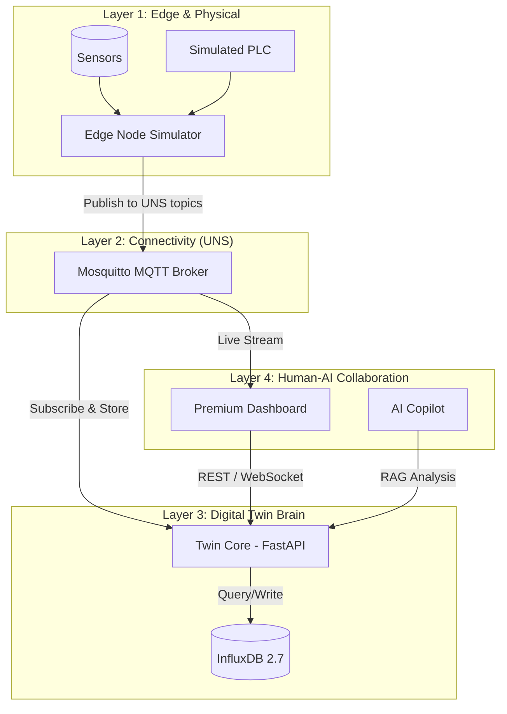

# 🏛️ Technical Architecture: Industry 5.0 Digital Twin

This document details the architectural layers and data flow of the Digital Twin Factory.

## 1. High-Level Architecture

The system follows a 4-layer architecture inspired by the **ISA-95** standard but modernized for the **Unified Namespace (UNS)** approach.



---

## 2. The Unified Namespace (UNS)

The UNS is the backbone of the project. Instead of traditional point-to-point connections (e.g., PLC to SCADA), all systems communicate through a single, shared name space.

### Topic Structure
We use a hierarchical structure:
`Factory/{Area}/{Line}/{Machine}/{Tag}`

**Examples:**
- `Factory/Area1/Line1/Machine3/Temperature`
- `Factory/Area1/Line1/Machine3/Vibration`
- `Factory/Area1/Line1/Machine3/OEE`

### Data Format (Simplified Sparkplug B)
Messages are sent as JSON objects containing value, unit, timestamp, and status:
```json
{
  "value": 24.5,
  "unit": "°C",
  "timestamp": "2026-05-15T14:00:00Z",
  "status": "ONLINE"
}
```

---

## 3. Component Breakdown

### A. Edge Node (Resilience Layer)
- **Role**: Simulates the physical factory and performs local "Edge AI" analysis.
- **Resilience**: If the Edge Node detects a critical vibration (Vib > 5mm/s), it generates an internal alert and publishes it to the UNS immediately. This ensures that safety logic remains local to the "Field".

### B. Twin Core (Context Layer)
- **Role**: The state engine of the factory. It keeps an in-memory "Shadow" of the entire UNS.
- **AI Brain**: Implements a Mock-RAG (Retrieval-Augmented Generation) logic. When a user asks a question, the Twin Core fetches the current state from the UNS shadow to provide a context-aware answer.

### C. Premium Dashboard (Visual Layer)
- **Role**: Real-time visualization and Human-Machine Interface (HMI).
- **Tech**: React + Tailwind + Framer Motion.
- **Features**:
    - **UNS Explorer**: Direct visual tree of the MQTT broker.
    - **What-if Simulator**: Allows operators to test scenarios (e.g., speed vs. energy) before applying changes to the real factory.

---

## 4. Data Flow Scenarios

### Scenario 1: Predictive Maintenance
1.  **Edge Node** detects a gradual increase in vibration.
2.  **UNS** topic `Factory/Line1/Machine3/Vibration` is updated.
3.  **Twin Core** saves data to **InfluxDB**.
4.  **Operator** asks the **AI Copilot**: *"Is Machine 3 healthy?"*.
5.  **AI Copilot** queries the Twin Core, sees the vibration trend, and responds: *"Warning: Vibration is rising. Recommended check in 4 hours."*

### Scenario 2: Sustainability Optimization
1.  **Edge Node** publishes `Energy` and `CO2` tags.
2.  **Dashboard** displays the **Sustainability KPI**.
3.  **Operator** uses the **What-if Slider** to reduce speed by 10%.
4.  **Dashboard** shows an estimated 15% reduction in CO2 footprint.

---

## 5. Security (OT/IT)
- **Isolation**: Services are containerized via Docker.
- **Broker**: Mosquitto supports ACLs and TLS for secure industrial communication.
- **Authentication**: InfluxDB uses token-based authentication.
